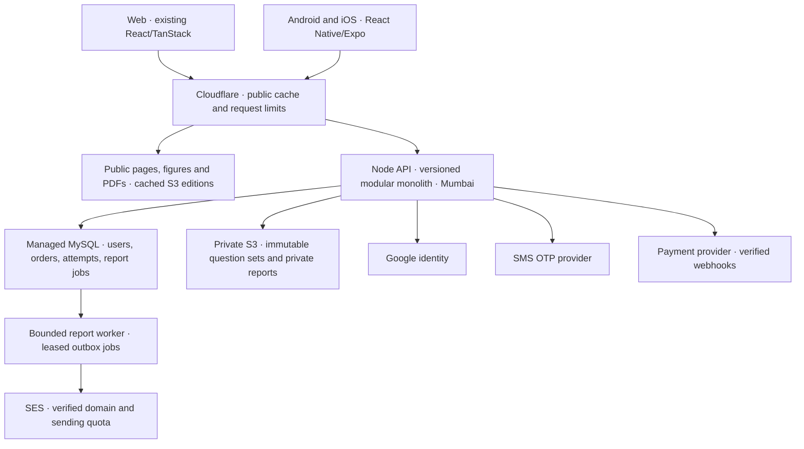

# DekhoExams student platform

20 November 2026. Design and implementation plan; this is not a claim that the new services are live.

## Product decisions

One account and attempt history across web, Android and iOS. Public PYQ reading/downloads remain discovery entry points. Account-based formal mock attempts get server-side eligibility, timing, scoring and reports. Existing browser-only practice remains labelled practice until that migration is complete.

Owner-confirmed pricing: ₹999 per month for unlimited mocks, stored as 99,900 paise. Start with a one-calendar-month pass with no automatic renewal; recurring billing is a separate explicit opt-in. Each coupon unlocks exactly one mock and never activates a monthly pass. A coupon is a separate single-test grant, not a misleading 100% discount on a month of unlimited access. WELCOME100 grants one free attempt. COMEBACK100 grants one more after the first attempt has been submitted; it cannot be reused. A school gets its own high-entropy coupon, exam scope, expiry, overall limit and one redemption per verified student. A coupon grants one entitlement; starting/resuming the same attempt never consumes another. No expiry/countdown or strike-through price without an actual policy. Final tax/invoice treatment needs merchant configuration. Renewal of an unexpired pass extends from its expiry; calendar-month arithmetic clamps to the last valid day and preserves UTC time.

## Student experience

1. Entry: browse free material, choose a formal mock, or sign in. Google and phone OTP are the two requested routes; iOS also needs a privacy-equivalent login option evaluated against Apple's rules. Do not embed Google authentication in a WebView.
2. Privacy/age eligibility before account collection: distinguish adult, minor and parent/guardian. Keep exact DOB optional. Implement verifiable guardian consent for minors before their live onboarding opens; a checkbox or a school coupon alone is not verification. No advertising pixels or unrelated behavioural tracking.
3. Contact card: name, email and mobile. Save a contact record only after a clear notice and submission. Retain verification status separately for email and phone. Google verifies its email; OTP verifies the phone. A typed email/phone is never treated as verified or used to merge accounts. Coupon redemption additionally requires that the profile phone matches that account’s verified phone identity; Google-only verification cannot claim multiple free grants using typed phone numbers. No automatic merging by an unverified address.
4. Education card: Class 10, 11, 12, graduation or masters; state and city. Save this slice independently. Announce a new card accessibly and allow Back; no total-step count or fake progress bar.
5. Optional birthday card: DOB or Skip. Save a separate preferences slice. Explain why it is requested. Do not block tests or coupons for skipping it.
6. Home: resume an active test, choose an exam, see eligible offers, recent reports and a short next action. All counts come from that student's records. Empty states replace invented statistics.
7. Checkout: price, selected test, duration, scoring rules, coupon entry, eligible suggested offers, amount due and one clear final action. ₹0 must read “Start free test”. Payment for the monthly pass opens only after a server-created order. The coupon alternative explicitly covers one mock; display ₹0 for that single-mock product. Keep school attribution optional and explain who can see reports.
8. Attempt: server-issued question/version set without answer keys; server deadline; autosave changed answers in small batches every 10–15 seconds and on navigation. Show saved/saving/offline status. Reconnect resumes the same attempt. An idempotent submit is safe to retry. The server scores only verified questions and uses the declared practice rules.
9. Result: score, accuracy, attempted/skipped, subject breakdown, elapsed time, comparison to the student's previous attempts and suggested revision. Use a practice-readiness indicator, not an invented probability of admission/selection. Question review stays on-screen. The branded downloadable report contains KPIs, no answer dump.
10. Account: edit profile, verify contacts, manage devices, explicit report-email preference, consent history, data export and account deletion. Deletion revokes sessions and removes/anonymizes learning data subject to necessary payment record retention.

## Admin and school operations

- Owner/admin, content reviewer and school roles are distinct. Admin access requires server-side permission checks and stronger authentication. Bootstrap an explicit owner; never make the first signup an admin.
- School directory with contact, status, exam scope and coupon issuance/revocation. High-entropy school codes are shown only at issue; store hashes. Audit issue, edit, revoke and access events.
- Student list: paginated search, contact/education/onboarding completion and attempts. Mask contact data by default. Ordinary school staff see school-scoped aggregates; identified reports require documented permission. Exports must have the same permission checks as the UI.
- Coupon controls: expiry, total redemption cap, exam scope and one-use-per-student constraint. Public codes have per-student limits too. Lock rows and insert entitlement/order/redemption in one transaction; an expired or exhausted code fails without a partial order.
- Revenue/order reconciliation: pending, paid, failed, refunded; gateway webhooks are authenticated, idempotent and matched to server order, amount and currency. A browser success callback never grants access. Refunds have an explicit policy and audit trail.
- Reports: attempts, completion, accuracy by subject, cohort aggregates with sensible minimum group size, and delivery failures. “Student tracking” means learning events, not location surveillance or keystroke recording.

## Architecture

Keep the current 1 GB Lightsail app and 1 GB managed MySQL. No infrastructure upgrades in this phase. Use Node's existing runtime and mysql2 pool, plain versioned SQL migrations and one API; no microservices or Kubernetes. A separate limited learner DB user keeps archive publication credentials out of writes. Payment and OTP secrets stay in server configuration; none enters Vite/mobile builds.

Modules: identity/session, profile/consent, catalog, offers/orders/entitlements, attempts/scoring, reports/delivery, admin/audit. API prefix `/api/student/v1`. Browser sessions use opaque random tokens hashed in the DB, Secure HttpOnly SameSite cookies, CSRF/origin checks and server-enforced roles. Native uses revocable rotating credentials in OS secure storage. Identity-linking requires proof of both accounts. Rate limits belong at the edge and provider boundary as well as the API; an in-process map alone is insufficient.

Public responses and authenticated responses have different cache rules. `/api`, account/admin, checkout, attempt and report responses are `private, no-store`, noindex and absent from sitemaps. Never put session, OTP, signed report URL or student PII into a shared cache key/log. Keep anonymous content fetching independent of the session cookie so logged-in reading does not force every public page to MySQL. Existing edge caching currently bypasses HTML cache when cookies exist; that must be measured and deliberately adapted before broad account launch.

## Data model and algorithms

Versioned SQL is in `server/student/schema.sql`. Logical ownership:

| Records | Storage and access |
| --- | --- |
| Contact, identity verification, education and optional DOB | MySQL; three independently saved slices; owner-only APIs |
| Sessions and OTP challenges | MySQL; token hashes, TTL, purpose binding, attempt/rate limits |
| Schools, coupon rules, redemptions, orders and entitlements | MySQL; unique constraints and transactions |
| Attempt headers, changed answers and aggregate reports | MySQL; user-scoped, stable question/version references |
| Questions/keys and reports | Private versioned S3 objects; server authorizes access; no public paid answer bundle |
| Email job state and audit events | MySQL; retry/lease indexes, bounded retention; no OTP bodies in logs |

Use indexed equality lookups for sessions/identities/codes, keyset pagination `(created_at,id)` for attempts/audit, and unique `(student,coupon)` / `(student,idempotency_key)` / `(order,entitlement)` constraints. Use maps keyed by immutable question ID when assembling answer batches; never match questions by text or mutable array position. Grade a frozen set in O(question count); don't rescan the whole archive per answer. Store money as integer paise. Maintain summaries on submit; don't run full answer-table scans on each dashboard visit. Composite indexes must match actual queries and be checked with EXPLAIN.

## Capacity target and its limits

One million visitors/day averages 11.6 visits/second. At 10 dynamic requests/visit, that is about 116 API requests/second before peak traffic, answer saves, OTP or report jobs. A 10× arrival peak implies roughly 1,160 API requests/second. These are planning scenarios, not measured capacity. A 99% public CDN hit rate reduces public origin traffic but does not remove authenticated writes.

The present single app and single small database have no application high availability; a cache miss surge or simultaneous exam submit can exhaust them. Design for bounded work, reject excess load cleanly and maintain autosave retries, but do not advertise a one-million-user SLA on this setup. Do not stress production to prove it.

Prelaunch gates: deterministic integration/concurrency tests in an isolated MySQL schema; 1, 5, 10, 25, 50 concurrent-user ramp in staging with stops at API p95 >500 ms, errors >1%, free memory <200 MB, pool wait >100 ms or sustained CPU >70%; then a capacity decision from actual traces. Test shared-cache hit ratios separately. Submission must be once-only under retries; no oversold/duplicate coupons, cross-user reads or forged scores. A day is not a concurrency measure. Report/API error budgets, database connections, backup restore and gateway reconciliation need operational ownership.

Protect the 1 GB plans: 4 learner connections initially, bounded queue, max 64 KiB JSON body, batched autosaves, query limits, no per-keystroke persistence, no synchronous PDF rendering in API requests. A separate bounded worker leases jobs; start at <=1 send/second while SES is sandboxed. Use retries with backoff, dead-letter/failure status, suppression/bounce handling and an idempotent report key. Report ready in the app immediately after scoring; email delivery is asynchronous and not guaranteed instantaneous. A durable queue service can replace the outbox when measured throughput justifies it; provisioning is a separate cost decision.

## Mobile route

Build real native Android/iOS clients with React Native/Expo using this API, shared contracts/validation and branding. Use native Google sign-in / Android Credential Manager and Apple-compatible login; use secure storage, universal/app links, file sharing, accessible question rendering and resume/reconnect tests. Avoid a website-in-WebView wrapper. Exact Expo/native versions are pinned when native implementation starts and tested in development builds, not assumed from an old template.

Digital mock access needs an Apple/Google store billing strategy and receipt verification; Razorpay web checkout cannot automatically be copied into both app stores. Evaluate store-specific billing and permitted school/enterprise access against current policies. Native build signing, Apple Developer / Play Console accounts, privacy labels, deletion URLs and device testing remain launch prerequisites. Do not publish unsigned APK placeholders or claim store availability from a responsive website.

## Rollout and acceptance

| Stage | Deliverable | Exit condition |
| --- | --- | --- |
| 1 · design/foundation | Clickable `/platform-preview`, this plan, SQL and tested offer policy | Owner can try all profile cards, checkout/offers, student/report and admin/school views; clearly labelled sample state |
| 2 · identity | Google, phone OTP, contact verification, three profile saves, guardian consent, sessions | Real provider test accounts; account linking/revocation/CSRF/rate-limit tests; no PII in public cache |
| 3 · commerce | School coupons, two public offers, paid orders and entitlement checks | Real DB race tests and gateway test-mode webhook/refund/replay tests; explicit owner role |
| 4 · formal tests | Server snapshots, saves, deadlines, submit, dashboards and private reports | Two devices/reconnect/retry/timeout tests; scoring parity; no premature key exposure |
| 5 · delivery | SES DKIM, bounce handling, bounded outbox and report links | Production access/quota approved; verified sender; delivery/bounce/suppression tests |
| 6 · mobile | Native iOS/Android builds and store billing | Physical device QA, signed internal/TestFlight builds, store review and private data deletion tests |
| 7 · capacity launch | Staged ramp and restore/reconciliation drills | Measured concurrency ceiling and decision on capacity; no assertion from daily traffic alone |

No live paywall, student PII collection or fabricated authentication is enabled by the design preview. External provider credentials and the guardian-consent/store-billing decisions gate dependent stages. Keep existing public content working while rolling these modules out.

## External setup and evidence

- Google OAuth: verified web origin/callback and separate native clients; only request identity scopes. Owner/admin Google identity must be explicitly supplied. [Google server OAuth](https://developers.google.com/identity/protocols/oauth2/web-server).
- SMS: provider account, Indian sender/template/DLT setup and spend/rate limits. SES is email, not mobile OTP. [MSG91 India OTP setup](https://msg91.com/help/sendotp/step-by-step-process-to-configure-otp).
- Razorpay: merchant/KYC, test then live server keys, signed webhook secret, capture/refund policy and approved final product pricing. [Server-created order and signature verification](https://razorpay.com/docs/payments/payment-gateway/web-integration/standard/integration-steps/).
- SES inspected in Mumbai on 20 November: sending enabled, production access false, 200/day, 1/second, 0 sent. `dekhoexams.com` sender identity created; DKIM verification pending. Other existing domain identities are unrelated and untouched. Verify DNS before requesting transactional production access. [SES sandbox limits](https://docs.aws.amazon.com/ses/latest/dg/request-production-access.html).
- Children: build a verifiable guardian-consent path and learning-only data policy before under-18 onboarding opens; exact DOB remains optional. The notified rules have phased commencement; do not infer that a generic school coupon establishes consent. [MeitY notified rules](https://www.meity.gov.in/static/uploads/2025/11/53450e6e5dc0bfa85ebd78686cadad39.pdf).
- [Expo authentication](https://docs.expo.dev/guides/authentication/), [native Google authentication](https://docs.expo.dev/guides/google-authentication/), [Apple login and digital purchase rules](https://developer.apple.com/app-store/review/guidelines/), [Google Play payments policy](https://support.google.com/googleplay/android-developer/answer/9858738).

## Current implementation boundary

Stage 1 is implemented: `/platform-preview` contains the student home, Google/OTP design walkthrough, three independent profile cards, monthly-vs-coupon checkout, sample test/KPI report, school admin overview and four-provider setup design. It is public sample state in memory, noindex and absent from sitemaps. It is not an authenticated student or admin service. Never paste real credentials into that preview.

The internal service foundation is in `server/student`: additive MySQL schema, separate profile writes, transactional one-mock coupon grants, verified payment capture for monthly passes, and owner-only AES-GCM encrypted settings. These services are tested in isolation and **not mounted as public API endpoints or migrated into production**. Controllers, actual provider calls, session middleware, guardian verification, formal test endpoints, private report delivery and native clients remain subsequent implementation stages. An encrypted row or a filled form does not prove a provider connection.

Initial tests: six policy/security tests and isolated local MySQL race tests (20 booking retries; seven students/two school slots; 12 payment replays). Local MySQL is 9.6; the managed database compatibility, backups, restore, delivery and capacity gates still need staging verification. No live load test or one-million-user certification is claimed.
